<p align="center">
  
</p>

<h1 align="center">Minha Casinha</h1>

<p align="center"><strong>Draw the floor plan of your house. You do not have to be an architect.</strong></p>

<p align="center">Live demo: <a href="https://minha-casinha.vercel.app">https://minha-casinha.vercel.app</a></p>

> **Em português.** O app Minha Casinha é um editor de planta baixa para quem não é arquiteto. Você desenha o terreno, os cômodos, as portas, as janelas e os móveis em escala real, no celular ou no computador. O app mostra a área útil de cada cômodo, simula o sol de São Paulo e exporta a planta em PDF, SVG ou PNG para você mandar ao seu arquiteto ou engenheiro. Tudo fica no seu navegador: não tem cadastro e nada vai para a internet sem você mandar.

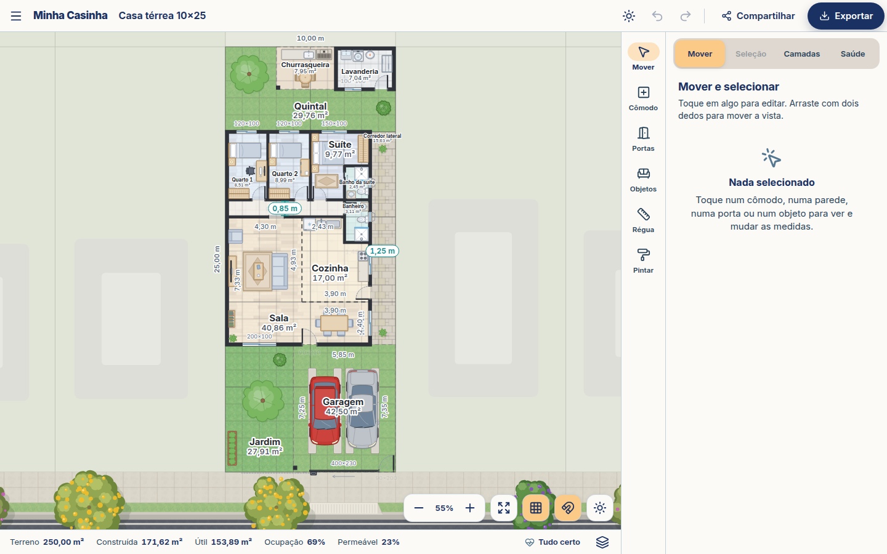

## The app

- A floor plan web app for laypeople in Brazil. The interface is in Brazilian Portuguese.
- Draw a single-storey house on your lot: rooms, walls, doors, windows, gates, furniture and the garden.
- Each room shows its net area: the area inside the walls, the number that counts when you buy floor tiles.
- Export a clean PDF and send it to your architect or engineer.
- It works on a phone of 320 px and on a desktop. Install it as an app. It works offline.
- Everything stays in your browser. There is no account and no server.

## Use cases

| | |
|---|---|
| 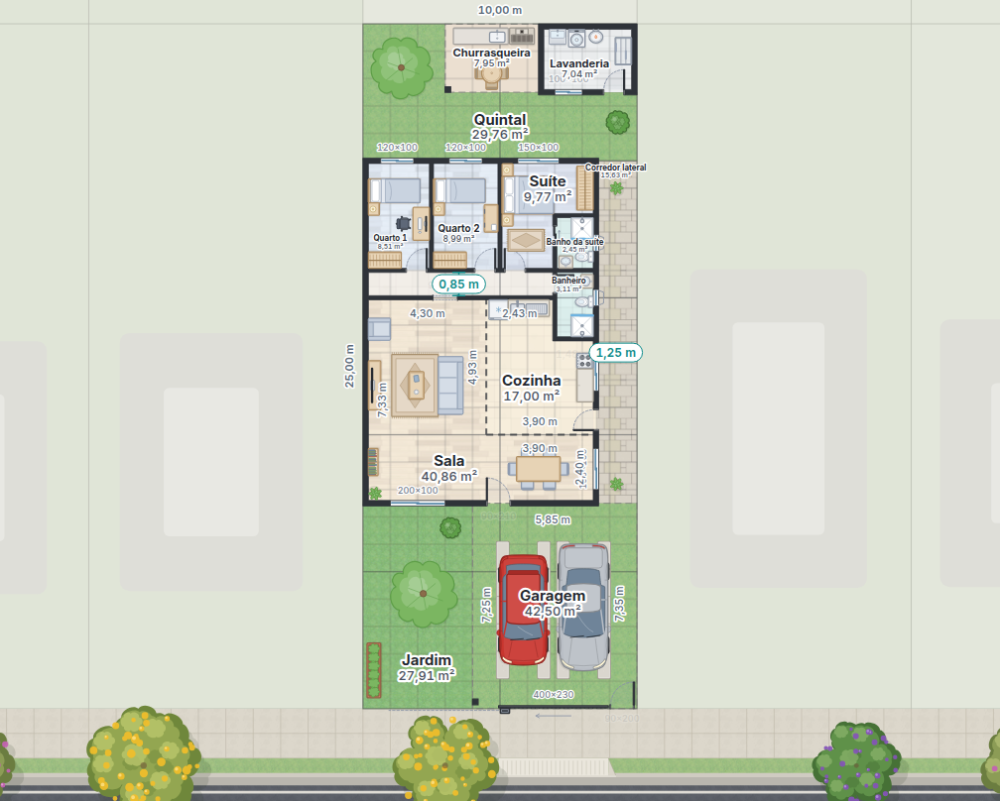 | 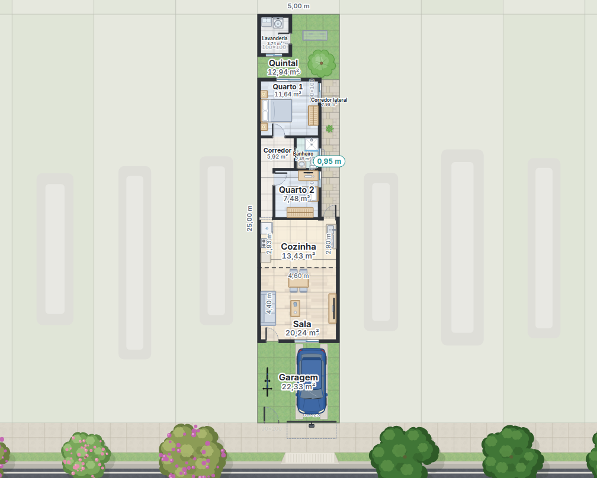 |
| **Test a house idea.** Open the example "Casa térrea 10×25" and change it: move a wall, add a bedroom, try other furniture. | **Make a narrow lot work.** The example "Casa geminada 5×25" has walls on both side lot lines and a side passage for light and air. |
| 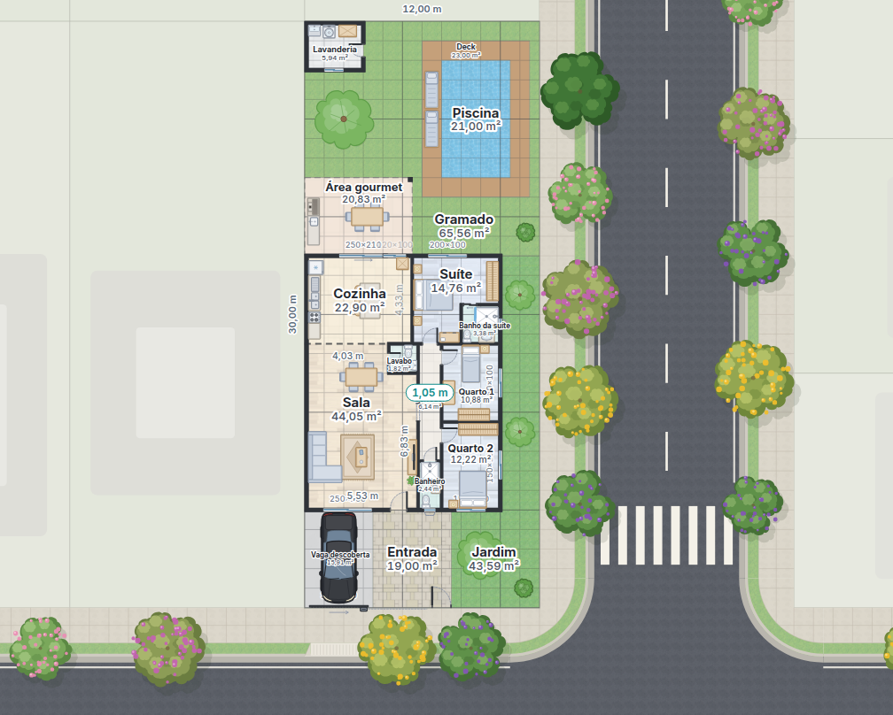 | 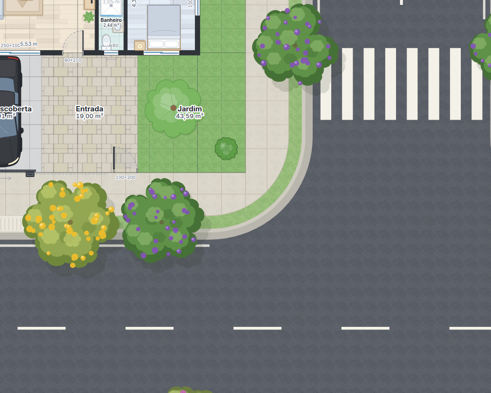 |
| **Plan the leisure area.** The example "Casa de esquina 12×30" has a pool, a covered gourmet area and a garden. | **See the street.** A corner lot gets the sidewalk, the trees and the rounded curb on both streets. |
| 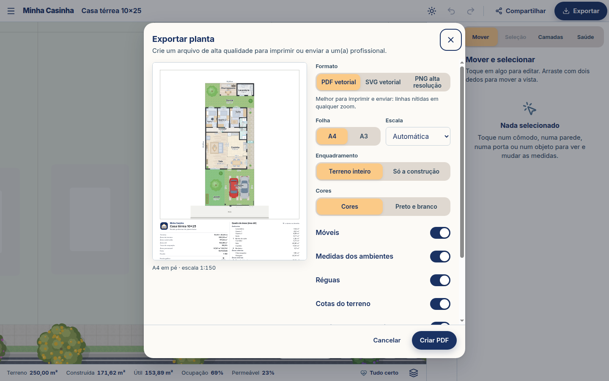 | 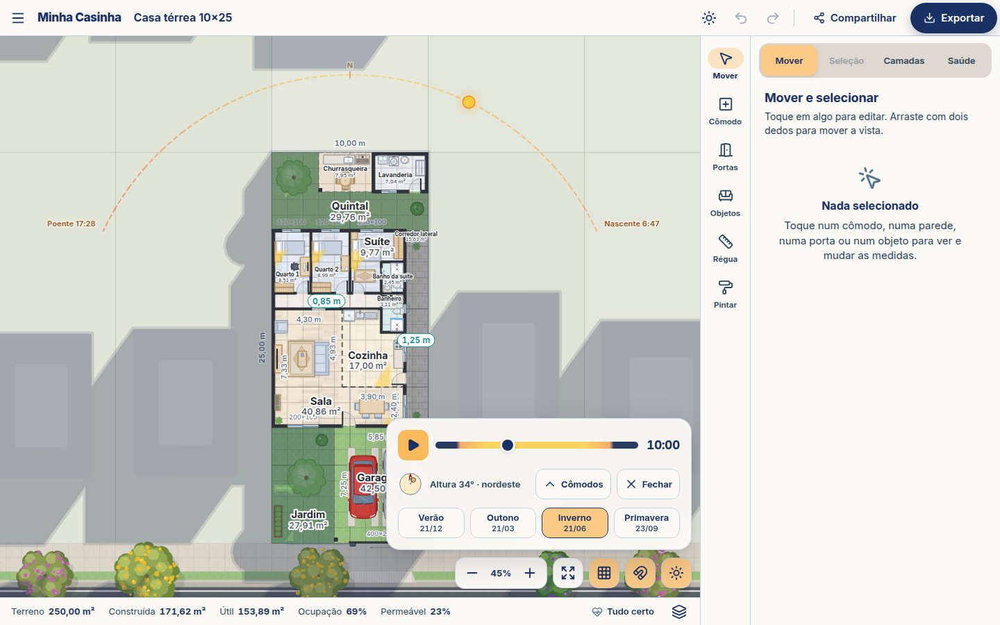 |
| **Send it to your architect.** The PDF has a title block, an area table, a scale bar and a north arrow. | **Find the sunny rooms.** Move the sun over the day and the year, and see which rooms get the morning sun. |

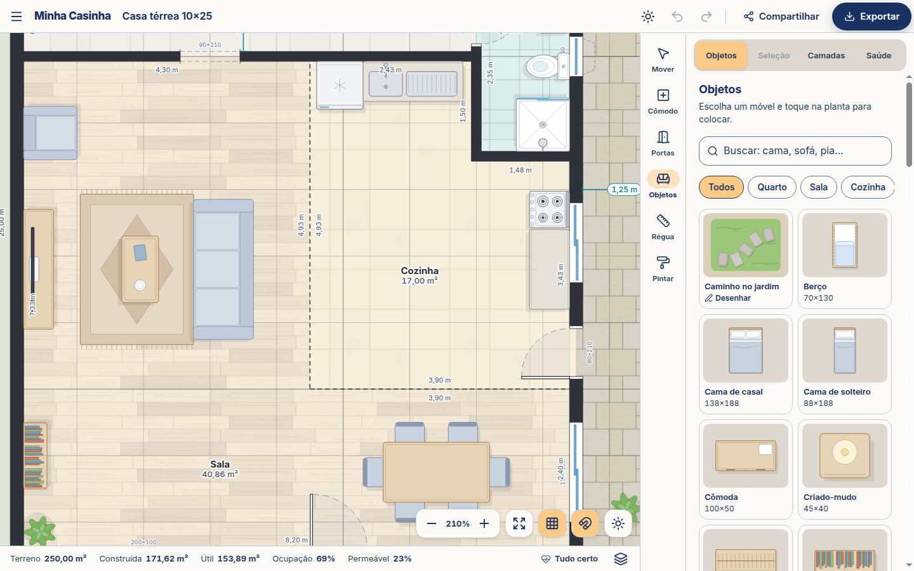

The catalog of furniture and fixtures, all at real size.

### On the phone

| | | |
|---|---|---|
| 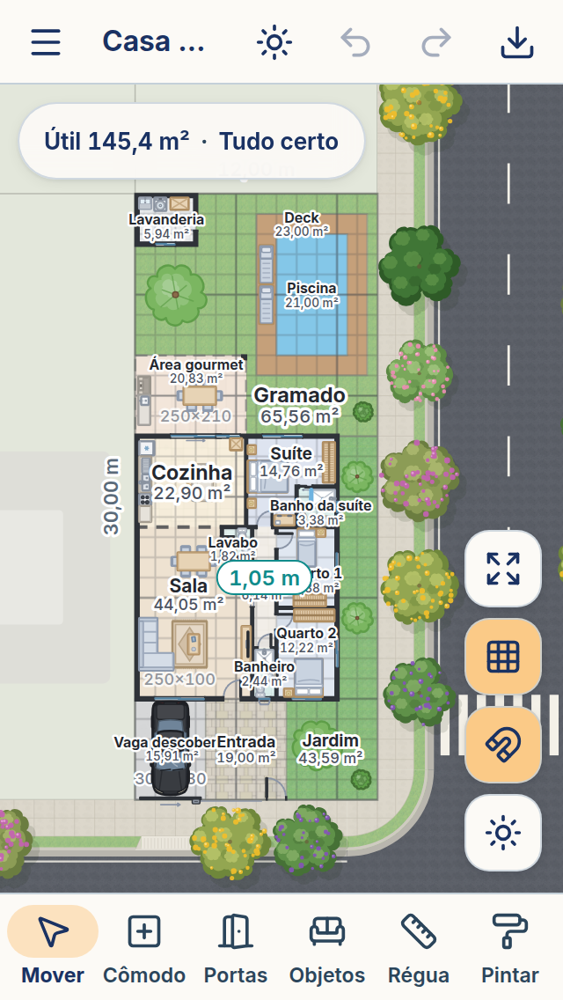 | 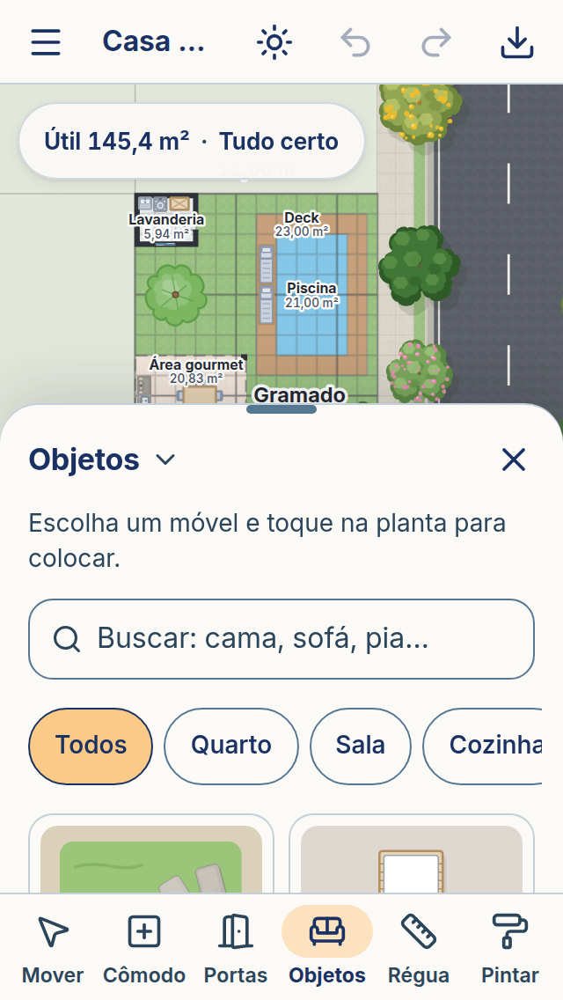 | 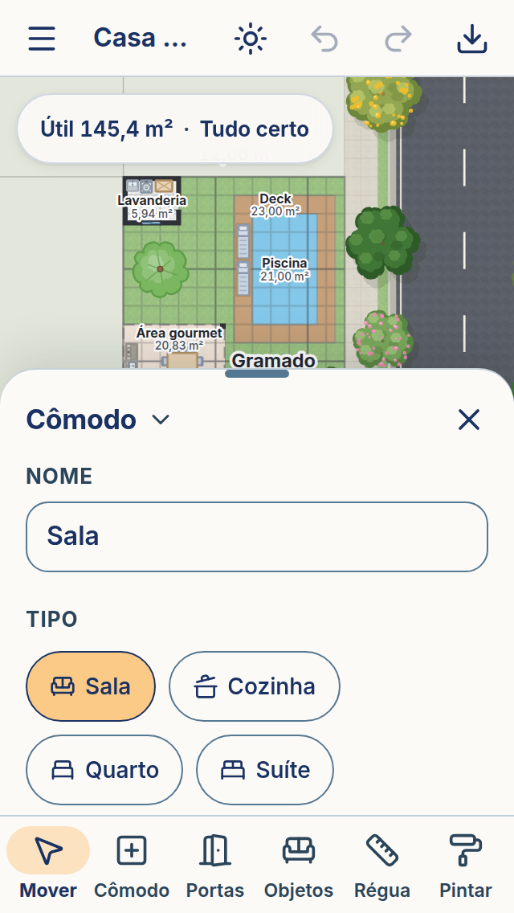 |
| The editor on a phone of 320 px. | The catalog in a bottom sheet. | The inspector of a room. |

## Contents

- [Features](#features)
- [Keyboard shortcuts](#keyboard-shortcuts)
- [Privacy](#privacy)
- [The `.casinha.json` file](#the-casinhajson-file)
- [Tech stack](#tech-stack)
- [Local development](#local-development)
- [Supply chain](#supply-chain)
- [Not a professional project](#not-a-professional-project)
- [License](#license)

## Features

### Lot

- A wizard asks for the front and the depth of the lot in meters, with presets such as 5 × 25, 10 × 25 and 12 × 30.
- Select the street side, a corner lot and a lot wall.
- The app draws the sidewalk of São Paulo, the street and neighbor houses of the same size.
- A corner lot gets the intersection of the two streets, with rounded curbs.
- Edit the street trees: species, size and position.

### Rooms and walls

- Drag to draw a room. A magnet keeps the corners on a 0,5 m grid.
- The walls come from the rooms. Select the wall thickness from Brazilian presets: brick on edge (15 cm), brick flat (25 cm), ceramic blocks and concrete blocks. The default external wall in São Paulo is 20 cm.
- Each room shows its name, its net area and the length of its walls.
- Carve a room with a new room, divide a room, merge two rooms, or remove the wall between two rooms.
- Drag a shared wall: the two rooms change together.
- Resize a room with handles, as in Photoshop.
- Copy, paste and duplicate rooms.
- Indoor rooms, covered areas (garage, porch, gourmet area) and outdoor areas (lawn, garden, pool, deck, parking).

### Doors, windows and gates

- Doors stick to house walls. Windows stick only to external walls. Gates stick only to the lot wall.
- Set the hinge side and the swing side of each door.
- Each opening shows its size in a small label, for example "80×210".
- An electric gate on the street gets an automatic ramp in the sidewalk.

### Furniture and fixtures

- About 55 top view symbols: bathroom, kitchen, living room, bedroom, office, laundry, garden, garage and structure.
- Real-size cars: a hatch (HB20 class) and a sedan (Corolla class), and concrete wheel strips for a grass driveway.
- Items snap their back to the nearest wall and turn to face the room.

### Measure and paint

- Rulers measure the clear width from wall face to wall face. A tap in a space makes a ruler that measures again when a wall moves.
- 17 vector floor textures and colors: wood, porcelain, ceramic, hydraulic tile, burnt cement, marble, deck, stone, grass, water and more.
- A grid with a line every 1 m.

### Save and share

- Undo and redo (Ctrl+Z and Ctrl+Y).
- The app saves each change in the browser. Keep many plans, and duplicate a plan to test an idea.
- Save and open `.casinha.json` files.
- Share a link: the plan goes inside the link, not to a server.
- A plan that is open in a second tab opens read-only.

### Export

- Vector PDF in A4 or A3, with a title block, an area table, a scale bar and a north arrow.
- SVG and high resolution PNG.

### Sun and shadows

- A sun and shadow simulation for São Paulo, for each day of the year and each time of day.
- A sun summary for each room.

### Help and fun

- Short sounds, haptics on phones and small effects for each action.
- A ghost hand shows how to use each tool the first time.
- A short lesson about net area on the first rooms.
- "Saúde da planta" gives friendly tips: a room with no door, a small bedroom, a door that hits a piece of furniture.

### App

- Installable PWA. It works offline after the first visit.
- It works on phones from 320 px wide, with touch: one finger for the tools, two fingers to move and zoom.

## Keyboard shortcuts

| Action | Keys |
|---|---|
| Move and select | V |
| Draw a room | R |
| Outdoor area | A |
| Divide a room | P |
| Doors and windows | O |
| Furniture and objects | F |
| Ruler | M |
| Paint | B |
| Show or hide the grid | G |
| Delete the selection | Delete |
| Undo | Ctrl+Z |
| Redo | Ctrl+Shift+Z or Ctrl+Y |
| Duplicate | Ctrl+D |
| Copy and paste | Ctrl+C and Ctrl+V |
| Move 5 cm (50 cm with Shift) | Arrow keys |
| Turn an item 90° | E and Shift+E |
| Cancel or clear the selection | Esc |
| Help and shortcuts | ? |

On a Mac, use Cmd in place of Ctrl.

## Privacy

- Everything stays in your browser. Your plans are in the IndexedDB of your browser.
- There is no account, no server, no analytics and no cookies.
- A plan leaves your device only when you export a file or share a link.
- A share link holds the compressed plan after the `#` of the address. Browsers do not send this part to the server.
- When you clear the data of the site in your browser, your plans go away. Save a `.casinha.json` file to keep a copy.

## The `.casinha.json` file

A plan file is plain JSON:

```json
{
  "format": "casinha.project",
  "schemaVersion": 1,
  "name": "Casa térrea 10×25",
  "lot": { "width": 10000, "depth": 25000, "frontSide": "bottom", "...": "..." },
  "structure": { "internal": 150, "external": 200, "boundary": 150 },
  "areas": [],
  "openBoundaries": [],
  "openings": [],
  "items": [],
  "rulers": []
}
```

- All lengths are integer millimeters. The origin is the top left corner of the lot.
- `areas` are rooms, covered areas and outdoor areas, with rectilinear shapes.
- The walls are not in the file. The app calculates them from the rooms.
- `openBoundaries` are pairs of rooms with no wall between them.
- The app examines each file before it opens it, and repairs or removes data that is not valid.

## Tech stack

- React 19 and TypeScript 7, built with Vite 8.
- Zustand and Immer for the state, with undo and redo.
- Zod for the file schema.
- jsPDF and svg2pdf.js for the vector PDF.
- idb for IndexedDB.
- vite-plugin-pwa for the offline app.
- ZzFX for the synthesized sounds.
- Lucide for the icons, Inter for the text.
- Biome for the format and the lint.

## Local development

You need Node.js 22.12 or newer.

```sh
git clone https://github.com/salvimateus/my-house-planner.git
cd my-house-planner
npm install
```

Start the dev server:

```sh
npm run dev
```

Make the production build in `dist/`:

```sh
npm run build
```

Other scripts:

- `npm run typecheck`: examine the types.
- `npm run lint`: run Biome.
- `npm run templates`: build the example plans in `src/templates/` and examine them.
- `bash scripts/build-icons.sh`: make the PNG icons from `docs/images/logo.svg` (needs ImageMagick).

## Supply chain

- The `.npmrc` file has `min-release-age=14`: npm does not install a package version that is less than 14 days old.
- The `.npmrc` file also has `save-exact=true`: each dependency has an exact version, with no range.
- After each install, run `npm audit signatures` to examine the registry signatures of the packages.

## Not a professional project

> [!WARNING]
> Minha Casinha is a tool to test ideas. It is not an architecture or engineering project. The areas and the sizes are approximate. Before you build, get a project from an architect or an engineer, and the approval of your city.

## License

MIT. Made by Mateus Salvi ([@salvimateus](https://github.com/salvimateus)). See [LICENSE](LICENSE).
